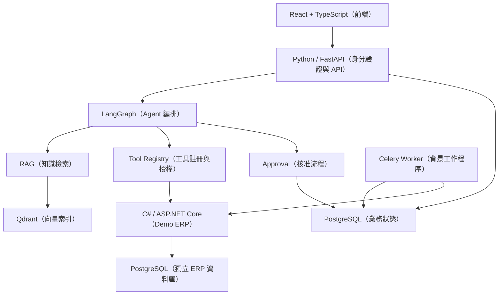

# Enterprise AI Operations Agent（企業 AI 營運代理系統）

> **目前階段：M1 已於 2026-11-13 有條件驗收通過，開始 M2 文件與 RAG 開發。** 完整系統及業務功能尚未通過產品驗收；歷史登出 500 保留為[已知問題](docs/development/issues/LOGOUT-500.md)。

本專案是可公開檢視的企業 AI Agent + RAG（檢索增強生成）參考實作，包含 **SOP 知識問答、庫存與銷售分析、採購建議及人工核准、Agent 執行監控**。重點為跨系統整合、權限、安全交易與可復原性。

## MVP（最小可行產品）

| 模組 | 規劃功能 | 狀態 |
|---|---|---|
| SOP 知識問答 | 文件上傳、Hybrid Retrieval（混合檢索）、引用來源、ACL（存取控制清單） | 規劃中 |
| 庫存與銷售分析 | 呼叫受控 ERP API、確定性庫存與銷售計算 | 規劃中 |
| 採購與人工核准 | 建議草稿、審核、重新驗證、冪等 ERP 寫入 | 規劃中 |
| Agent 執行監控 | Run 歷程、Trace（追蹤）、延遲、Token 與成本 | 規劃中 |

## 預定架構



- 採用 Modular Monolith（模組化單體）+ Worker（背景工作程序），暫不導入 Microservices（微服務）。
- AI 核心：Python、FastAPI、LangGraph、Qdrant、Redis、MinIO。
- **Demo ERP：C# + ASP.NET Core Web API**，透過 OpenAPI（開放 API 規格）與 AI 核心整合；使用獨立 PostgreSQL Schema／資料庫帳號，首選獨立資料庫。
- LLM（大型語言模型）負責語意理解與說明；庫存計算、授權、審核及交易寫入由確定性程式負責。
- PostgreSQL 為業務資料的 Source of Truth（權威資料來源）；Qdrant 是可重建的檢索索引。

## 技術文件

| 文件 | 內容 |
|---|---|
| [系統架構](docs/architecture/SYSTEM.md) | 模組職責、資料流與可靠性 |
| [資料庫 Schema（結構）](docs/database/SCHEMA.md) | PostgreSQL DDL（資料定義語言）與資料約束 |
| [API Contract（介面契約）](docs/api/CONTRACT.md) | REST、SSE、ERP Tool 規範 |
| [Agent Workflow（代理程式工作流程）](docs/agent/WORKFLOW.md) | State、Node、核准及恢復 |
| [驗收測試](docs/testing/ACCEPTANCE.md) | 測試案例、量測門檻與發布條件 |
| [安全設計](docs/security/SECURITY.md) | 租戶隔離、工具授權、資料保護 |
| [ADR（架構決策紀錄）](docs/adr/README.md) | 設計取捨及替代方案 |
| [AGENTS.md](AGENTS.md) | AI Coding（AI 輔助程式開發）及文件規範 |
| [Codex 自主開發循環](docs/development/AUTONOMOUS_LOOP.md) | 自主開發、額度停止門檻、本機 Hook 與資訊安全 |
| [開發進度](docs/development/PROGRESS.md) | M1 進度與任務交接 |

## 預定開發順序

1. **M1**：基礎環境、身分驗證、Tenant（租戶）隔離、資料庫 Migration（結構遷移）。
2. **M2**：文件匯入、RAG、來源引用、檢索評估。
3. **M3**：C# Demo ERP、工具契約、Agent 與庫存分析。
4. **M4**：採購草稿、人工核准、Transactional Outbox（交易式寄件匣）與 Idempotency（冪等性）。
5. **M5**：監控、安全與故障恢復測試。
6. **M6**：公開 Demo、文件與 Release（發布）。

## M1 基礎骨架（環境驗證已通過）

已加入 React + TypeScript 前端、FastAPI 健康檢查、ASP.NET Core Demo ERP 健康檢查、兩套 PostgreSQL 資料庫、Alembic / EF Core 初始 Migration、Docker Compose 與 CI 建置設定。

2026-11-12 的 M1-01 本機驗證已通過 Compose 設定、映像建置、Python 測試、C# 與 React 建置、Alembic／EF Core 初始 Migration，以及兩個 API 的 HTTP 健康檢查。指令、結果及未驗證範圍見 [M1 開發環境指南](docs/development/GETTING_STARTED.md)與 [M1-01 驗證紀錄](docs/development/M1-01-VERIFICATION.md)。這不代表 M1 的身分驗證與租戶隔離已完成。

## Git 機密防護（本機必須另行啟用）

已新增 `.githooks/pre-commit` 與 Gitleaks（機密掃描）CI。**Git Hook 不會在 Clone 時自動啟用**；請先依照 [自主開發循環文件](docs/development/AUTONOMOUS_LOOP.md) 安裝 Gitleaks 並執行：

```powershell
git config --local core.hooksPath .githooks
python scripts/security/check_staged_secrets.py
```

掃描只是防線之一，任何真實金鑰都不可加入 Git 暫存區，更不可推送到遠端。

## 專案狀態與使用限制

- 目前可用 `docker compose up -d` 啟動 M1 基礎環境；身分驗證、租戶隔離與 React 登入流程已完成測試，M1 遠端 CI 成功並標記為[有條件驗收通過](docs/testing/ACCEPTANCE.md)。單次登出 500 的原因仍未確認；M2 及後續業務 API 尚未完成。
- 未完成安全、交易一致性及 E2E（端對端）測試前，不可接入真實採購交易。
- 所有展示資料必須為 Synthetic Data（合成資料），禁止提交真實企業資料、個資與密鑰。
- 本專案採用 Apache License 2.0（Apache 2.0 開源授權），詳見 [LICENSE](LICENSE)；第三方套件與整合服務仍須依各自授權條款評估。
- 測試門檻為**預設驗收目標**，並非已取得的測試結果。

**設計基準版本：v0.1，2026-11-12。** 實作時若改變設計，必須同步更新文件、測試與 ADR。
