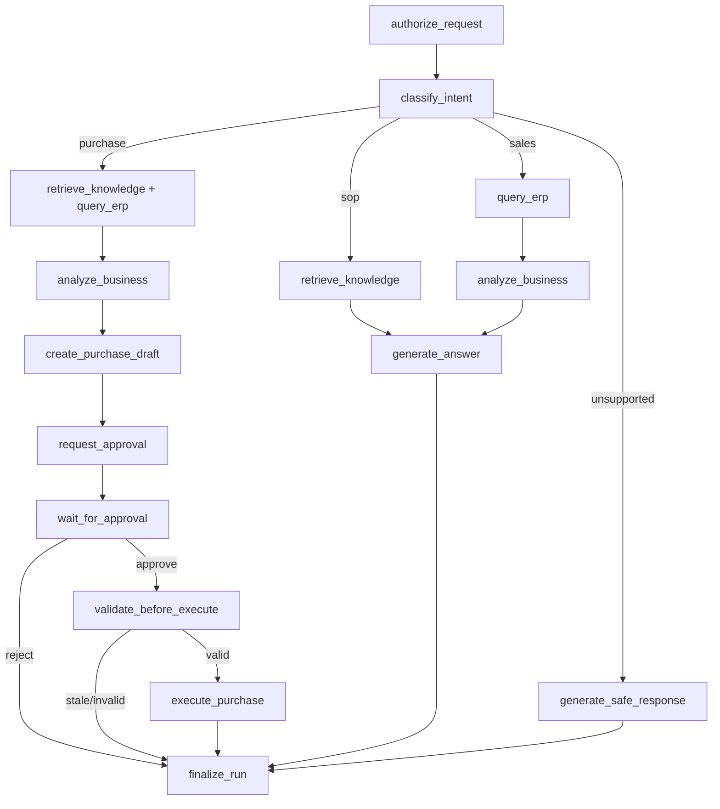

# LangGraph Workflow Design v0.1

> Proposed graph design; no graph implementation yet. Graph state is orchestration state, **not** authoritative financial transaction state.

## State contract

```python
from typing import TypedDict, NotRequired

class AgentState(TypedDict):
    run_id: str
    tenant_id: str
    user_id: str
    thread_id: str
    user_message: str
    status: str
    intent: NotRequired[str]
    knowledge_refs: NotRequired[list[dict]]
    tool_results: NotRequired[list[dict]]
    analysis_result: NotRequired[dict]
    purchase_draft_id: NotRequired[str]
    approval_id: NotRequired[str]
    approval_status: NotRequired[str]
    final_answer: NotRequired[str]
    error_code: NotRequired[str]
    retry_count: NotRequired[int]
```

The backend injects trusted `tenant_id`/`user_id` from authenticated context. Large content and sensitive ERP outputs stay in protected storage; state carries references and bounded summaries. Use explicit message reducer and history limits for multi-turn conversation.

## Nodes

| Node | Responsibility | Deterministic / model |
|---|---|---|
| authorize_request | Validate actor/tenant/warehouse/tool permissions | deterministic |
| classify_intent | Route SOP, sales, purchase, unsupported | LLM with schema validation |
| retrieve_knowledge | ACL-filtered retrieval and evidence references | retrieval service |
| query_erp | Authorized, bounded read-only ERP calls | tool adapters |
| analyze_business | Reorder point, inventory position, lead time, MOQ | deterministic |
| generate_answer | Explain results grounded in references | LLM |
| create_purchase_draft | Persist versioned recommendation | DB transaction |
| request_approval | Freeze draft and create approval | DB transaction |
| wait_for_approval | Pause until trusted decision | interrupt |
| validate_before_execute | Re-read scope, inventory/policy/prices/version | deterministic |
| execute_purchase | Dispatch idempotent write, reconcile | guarded worker |
| finalize_run | Persist terminal result/status | deterministic |
| handle_failure | Classify, log, retry boundedly or terminate | deterministic |

## Routing



Any node can route to `handle_failure`. Independent evidence and ERP reads may execute concurrently after passing authorization; never permit stale ACL results in the response.

## Approval security and resumption

1. Graph creates a draft and approval record **before** entering an interrupting node. Side effects are idempotent and outside any repeatable interrupt code.
2. User POSTs decision to Approval API. API validates active membership, authority, version, warehouse scope and self-approval policy.
3. In one DB transaction: lock records; update approval status; append audit event and outbox event.
4. Worker resumes the graph with the same checkpoint thread ID; resume payload contains only trusted `approval_id`/decision reference. **Reload DB record** to determine actual decision.
5. On approved decision: revalidate current ERP state and compute purchase restrictions. If changed, mark stale and demand fresh approval.
6. ERP write uses stable idempotency key; reconcile unknown outcomes and persist external document ID.

LangGraph `interrupt()` can re-enter a node when resumed; repeating side effects must therefore be moved to separate idempotent nodes or protected with persistent uniqueness constraints. Never trust an arbitrary `{"approved":true}` resume payload.

## Deterministic inventory formula (baseline)

- `ADS = 30-day fulfilled demand / 30` (document stockout bias)
- `ROP = ADS × lead_time_days + safety_stock`
- `IP = on_hand + open_incoming - outstanding_committed_demand`
- Trigger if `IP <= ROP`.
- `Q = max(0, target_stock - IP)`; round up to pack multiple and MOQ.
- Validate units, source versions, lead time and price; use Decimal arithmetic.

Example: `on_hand=120, committed=35, incoming=40 → IP=125`, `ADS=10, lead time=7, safety stock=30 → ROP=100`, thus no reorder. Avoid counting the same reserved amount twice as backorders.

## Reliability

- One worker ownership/lease per active run; terminal transitions are guarded.
- Explicit run states: queued → running → waiting_approval → running → completed/failed/cancelled.
- Checkpoint store in PostgreSQL plus an independent purchase DB state machine.
- External writes are at-least-once dispatch with idempotent ERP effect (not blanket exactly-once transport).
- Handle retry budget, timeout, fallback safe response, and reconciliation of `unknown` ERP results.
- Cancellation does not undo committed external operations.
- Emit trace ID and sanitized `agent_run_events` per node transition.

See [schema](../database/SCHEMA.md), [API contract](../api/CONTRACT.md), and [acceptance criteria](../testing/ACCEPTANCE.md).
