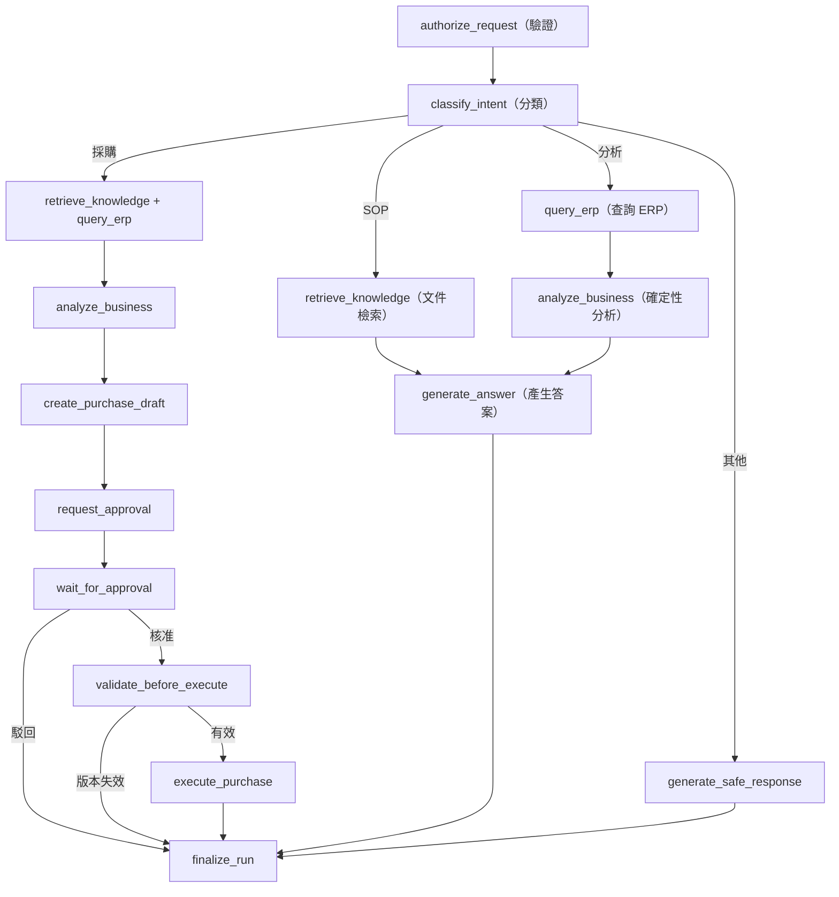

# LangGraph Agent Workflow（代理程式工作流程）v0.1

> **設計階段，尚未實作。** LangGraph State 用於編排流程，不是採購交易的授權或唯一狀態來源。

## 1. State（狀態結構）

```python
from typing import TypedDict, NotRequired

class AgentState(TypedDict):
    run_id: str
    tenant_id: str
    user_id: str
    thread_id: str
    user_message: str
    status: str
    intent: NotRequired[str]
    knowledge_refs: NotRequired[list[dict]]
    tool_results: NotRequired[list[dict]]
    analysis_result: NotRequired[dict]
    purchase_draft_id: NotRequired[str]
    approval_id: NotRequired[str]
    approval_status: NotRequired[str]
    final_answer: NotRequired[str]
    error_code: NotRequired[str]
    retry_count: NotRequired[int]
```

`tenant_id` 與 `user_id` 必須由驗證後端注入，模型不得修改。大型文件與完整 ERP 結果保存在受控儲存層，State 只保留識別碼與必要摘要。多輪對話應增加 Messages Reducer（訊息合併器）及歷程限制。

## 2. Node（節點）規格

| Node | 責任 | 執行性質 |
|---|---|---|
| `authorize_request` | 驗證人員、租戶、倉庫、工具權限 | 確定性 |
| `classify_intent` | SOP／銷售／採購／不支援意圖分類 | LLM + Schema 驗證 |
| `retrieve_knowledge` | 套 ACL 檢索及產生引用識別碼 | RAG |
| `query_erp` | 呼叫受控 C# Demo ERP Read API | Tool Adapter |
| `analyze_business` | 計算補貨點、庫存部位與 MOQ | 確定性 |
| `generate_answer` | 根據證據產生說明 | LLM |
| `create_purchase_draft` | 儲存具版本的採購建議 | DB Transaction |
| `request_approval` | 鎖定草稿並建立審核 | DB Transaction |
| `wait_for_approval` | 暫停並等待核准 | Interrupt |
| `validate_before_execute` | 重驗庫存、價格、政策、版本與權限 | 確定性 |
| `execute_purchase` | Outbox 發送受控 C# ERP Write API | Worker |
| `finalize_run` | 記錄結果及結束狀態 | 確定性 |
| `handle_failure` | 分類錯誤、有限重試與稽核 | 確定性 |

## 3. 路由



所有 Node 必須有 Failure Route（失敗路由）。授權後可平行檢索 SOP 與 ERP Read API，但回覆前需再次檢查引用的文件權限。

## 4. Human-in-the-loop（人工介入）與恢復

1. `create_purchase_draft` 與 `request_approval` 在暫停前完成，使用可重入、冪等的持久化操作。
2. 人員透過 Approval API 提交決策，API 檢查租戶、角色、倉庫、版本及 Self-approval（自行核准）限制。
3. 同一 DB Transaction 內更新 Approval，寫入 Audit 與 Outbox。
4. Worker 使用原本 Checkpoint `thread_id` 恢復 Graph；Resume Payload 只帶可信任的 Approval ID。
5. Resume 後重新查詢資料庫決策，不接受外部直接傳入 `approved: true` 進行授權。
6. 核准後重新查詢 C# Demo ERP 庫存／價格與政策；資料異動時標為 `stale`，重新送審。
7. 交易執行使用固定冪等鍵，Timeout 時先查詢 ERP 對帳介面。

LangGraph `interrupt()` 恢復時可能重新執行 Node 開頭，必須將不應重複執行的 Side Effect（副作用）移至其他節點，或使用資料庫唯一約束保護。

## 5. 確定性庫存計算

- `ADS = 最近 30 日有效銷售量 / 30`（需標註缺貨造成的銷售偏差）。
- `ROP = ADS * lead_time_days + safety_stock`。
- `IP = on_hand + open_incoming - outstanding_committed_demand`。
- `IP <= ROP` 時考慮補貨。
- `Q = max(0, target_stock - IP)`，再依 MOQ（最低訂購量）及 Pack Size（包裝倍數）進位。

範例：`on_hand=120, committed=35, incoming=40`，得到 `IP=125`；`ADS=10, lead_time=7, safety_stock=30`，得到 `ROP=100`，因此目前不需補貨。不能同時將同一筆保留量重複當作 Backorder（欠交需求）扣除。

計算須使用 Python `Decimal` 與 C# `decimal`，並保存 ERP 來源版本、計算參數與依據。

## 6. Run State（執行狀態）與可復原性

`queued → running → waiting_approval → running → completed / failed / cancelled`。

- 每個 Run 由單一 Worker Lease（租約）控制執行權。
- Checkpoint 採 PostgreSQL 官方實作；採購交易採獨立資料庫狀態機。
- Outbox 允許 At-least-once Delivery（至少一次傳遞），ERP 使用 Idempotency 確保單一業務效果。
- 每次 Node 轉移應記錄 Trace ID、時間、狀態與遮蔽敏感內容的事件。
- 取消執行不能回滾已完成的 ERP 採購寫入。

相關文件：[Schema](../database/SCHEMA.md) · [API](../api/CONTRACT.md) · [驗收規格](../testing/ACCEPTANCE.md)。
