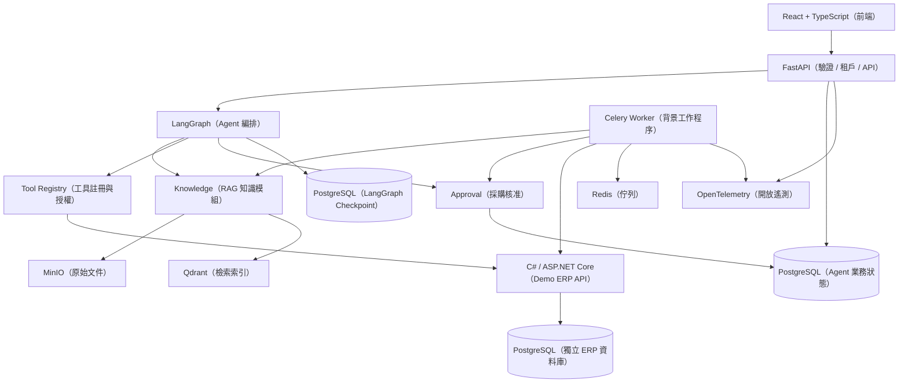

# 系統架構規格 v0.1

> **狀態：整體架構仍為設計規格；M1 基礎環境已實作並通過本機啟動驗證。** 更新日期：2026-11-12。詳見 [M1-01 驗證紀錄](../development/M1-01-VERIFICATION.md)。

## 1. 目標與範圍

建立可公開 GitHub、可獨立部署的 Enterprise AI Operations Agent（企業 AI 營運代理系統），涵蓋：

1. 具有來源引用與存取權限的 SOP 知識問答。
2. 透過 Demo ERP API 執行庫存與銷售分析。
3. 產生採購建議草稿，經人工核准後安全寫入 ERP。
4. 追蹤 Agent 執行、Token、成本、故障與恢復。

**MVP 不包含**：通用聊天平台、LLM 任意 SQL、無人核准的自主採購、多 Agent 自由協作、Kubernetes、跨區域高可用及真實企業資料。

## 2. 架構圖



**主要決策**：Modular Monolith（模組化單體）+ Worker（背景工作程序）。不在第一版拆成大量 Microservices（微服務）。

Demo ERP 使用 **C# + ASP.NET Core Web API**，以 REST／OpenAPI（開放 API 規格）對接 Python Agent；其資料庫與 AI 應用的業務資料分離，避免直接跨資料庫寫入。

## 3. 模組邊界

| 模組 | 責任 | 不允許 |
|---|---|---|
| Identity（身分與租戶） | JWT、Membership（成員資格）、RBAC、Tenant Context（租戶內容） | 信任 LLM 指定的身分 |
| Knowledge（知識） | 版本管理、索引、ACL 檢索、來源引用 | 由 Agent 任意修改權限 |
| Agent（代理程式） | 意圖判斷、流程編排、Checkpoint、答案生成 | 直接寫入 ERP 資料庫 |
| Tools（工具） | Schema 驗證、權限、逾時、結果限制 | 執行未核准工具或任意 SQL |
| Inventory（庫存分析） | 庫存部位、銷量、補貨建議 | 由 LLM 自行決定數值 |
| Purchasing（採購） | 草稿、核准、Outbox、冪等寫入 | 僅憑模型回答授權交易 |
| Observability（可觀測性） | Run Event、Trace、Metrics、Audit | 保存機密原始資料 |

所有 Domain Service（領域服務）使用經過後端驗證的 `ExecutionContext`；包含 `tenant_id`、`user_id`、可存取的倉庫範圍、`run_id`。HTTP Header、聊天內容與 LLM 輸出不可直接授權。

## 4. 主要資料流

1. 驗證使用者與 Tenant Membership（租戶成員資格）。
2. 依 Idempotency Key（冪等鍵）建立 Agent Run。
3. 根據意圖路由到 SOP、業務分析或採購流程。
4. SOP：以租戶與 ACL 篩選檢索、Rerank（重新排序）、再次驗證權限、附來源引用。
5. 業務分析：僅透過受控的 C# Demo ERP Read API 讀取資料，再以確定性程式計算。
6. 採購：建立鎖定版本的草稿、人工核准、資料重驗、Outbox 發送受控 ERP Write API。
7. 儲存執行狀態、遮蔽敏感內容的事件與 Trace，回傳結果。

## 5. 交易一致性及故障恢復

- LangGraph Checkpoint 與 ERP Transaction（交易）**不構成單一原子交易**。
- PostgreSQL 是採購草稿、核准與 ERP 執行狀態的 Source of Truth（權威資料來源）。
- 核准決策與 `outbox_events` 必須在同一 PostgreSQL Transaction 中提交。
- Worker 允許重複收到事件，但 ERP 必須用固定 `idempotency_key` 保證單一業務效果。
- ERP Timeout（逾時）後先依冪等鍵對帳，再決定是否重試。
- 執行前重新驗證草稿版本、採購政策、價格、庫存與使用者授權。
- 已完成的 ERP 交易不會因 Agent Run 取消而自動復原；需另有補償流程。

## 6. RAG（檢索增強生成）資料流

```text
文件上傳 → SHA256 → MinIO → Parser（文件解析）
  → Chunking（區塊切分）→ Embedding（向量嵌入）
  → Qdrant 索引 → 檢查 Ready → 切換發布版本

使用者查詢 → Tenant / ACL 篩選 → Dense + Sparse Retrieval（混合檢索）
  → Fusion / Reranking（融合與重新排序）
  → PostgreSQL 權限再次驗證 → Evidence Pack（證據集）
  → 有來源引用的回答／證據不足
```

原始文件及授權狀態保存在 PostgreSQL／MinIO，Qdrant 作為可重建索引。索引失效時必須回報依賴服務異常，不得捏造引用。

## 7. 部署與品質策略

開發環境預定以 Docker Compose 啟動 React、FastAPI、Worker、ASP.NET Core Demo ERP、PostgreSQL、Redis、Qdrant、MinIO 與可選的 Observability Collector（監控收集器）。

只對外公開必要 API；內部 ERP 與資料庫使用隔離網路與最小權限憑證。測試依 [驗收規格](../testing/ACCEPTANCE.md) 執行。**目前所有 SLO（服務水準目標）只是預設目標，尚未實測。**

延伸文件：[資料庫](../database/SCHEMA.md) · [API](../api/CONTRACT.md) · [Agent Workflow](../agent/WORKFLOW.md) · [ADR](../adr/README.md)。
