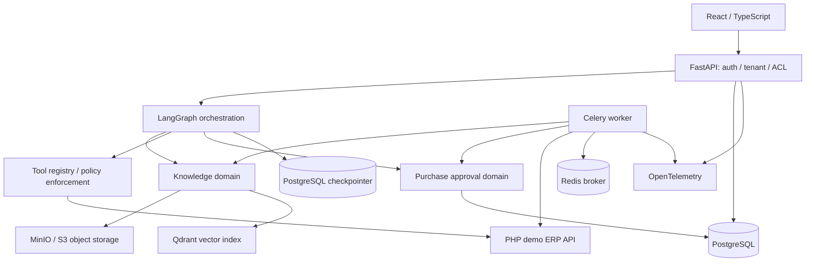

# System Architecture v0.1

> **Design proposal — not implemented.** Last updated: 2026-11-12.

## Goals and scope

Build an independently deployable, GitHub-public reference implementation for:
1. Evidence-backed SOP document Q&A with access control.
2. Inventory and sales analysis via a simulated ERP API.
3. Purchase recommendation with human approval before write.
4. Agent execution tracing, metrics and recovery.

**Non-goals for MVP:** general-purpose chatbot platform, arbitrary SQL generated by LLM, uncontrolled autonomous purchases, Kubernetes, multi-agent swarm, production HA or real enterprise data.

## Architecture



## Module boundaries

| Module | Responsibility | Prohibited dependency |
|---|---|---|
| `identity` | Authentication, membership, roles, tenant context | LLM-derived authorization |
| `knowledge` | Document versions, ingestion, ACL-filtered retrieval, citations | Agent decision authority |
| `agents` | Intent routing, tool coordination, checkpoints, result synthesis | Direct ERP DB writes |
| `tools` | Input schema, authorization, timeouts, response contracts | User-defined arbitrary tool execution |
| `inventory` | Inventory position, sales aggregation, reorder calculations | LLM-derived arithmetic |
| `purchasing` | Draft version, approval, outbox, idempotent ERP write | Approval based solely on model output |
| `observability` | Run events, trace correlation, metrics, sanitized audit | Raw secrets and unnecessary personal data |

All external operations use adapters/interfaces. Domain functions receive a validated `ExecutionContext` containing `tenant_id`, `user_id`, authorized warehouse scope, and `run_id`. HTTP headers, user text and model output are not trusted sources of authorization.

## Request lifecycle

1. Authenticate identity and resolve active tenant membership.
2. Create idempotent Agent Run with request correlation ID.
3. Route to SOP Q&A, sales analysis or purchase workflow.
4. For RAG: retrieve using tenant + document ACL filters, rerank, recheck permissions, produce source citations.
5. For analytics: fetch bounded ERP data through read-only tools; validate and compute with deterministic service.
6. For purchase: create versioned draft, send approval, suspend; resume only after trusted DB decision; revalidate data then dispatch write.
7. Persist status transitions, sanitized events and telemetry; publish result.

## Execution and transaction consistency

- LangGraph checkpoint storage is **not** part of the ERP's database transaction.
- PostgreSQL is source of truth for draft, approval, execution attempt and outbox states.
- Approval decision and outbox event are committed in the **same PostgreSQL transaction**.
- Worker claims outbox items with concurrency control. Duplicated delivery is expected and must be safe.
- ERP write uses a stable `idempotency_key` and an ERP-side uniqueness constraint. On timeout/unknown result, reconcile by key before retry.
- Revalidate warehouse permissions, draft version, current stock/prices/policy and actor authorization immediately before execution.
- Rejected/stale/expired drafts cannot be executed; canceled runs do not imply rollback of already committed ERP writes.
- Model failures cannot authorize writes. Use bounded retries and escalation after persistent failure.

## RAG lifecycle

```text
Upload → SHA-256 validation → object storage → parse → chunk
       → embeddings + sparse index → Qdrant index → readiness check
       → atomic published-version switch → retire old index later

Query → server-issued tenant/ACL filter → dense+sparse retrieval
      → merge/rerank → permission recheck → evidence pack
      → grounded answer + citation / insufficient evidence
```

PostgreSQL holds document ownership, version, ACL, index readiness and chunk source content. Qdrant is a derived, rebuildable index. Missing Qdrant data must produce a bounded error, never an invented citation.

## Deployment boundary

Initial Docker Compose services: frontend, FastAPI, Celery worker, demo PHP ERP, PostgreSQL, Redis, Qdrant, MinIO and optional observability collector. Network isolate internal ERP and databases. API is the only intended public business endpoint.

## Quality and tradeoffs

- Modular Monolith is easier to reason about, test and operate for one maintainer than early microservices.
- LangGraph provides durable workflow/checkpoints; the DB state machine protects financial actions independently.
- Queue + outbox enables recovery at the expense of eventual consistency.
- Dense+sparse RAG improves coverage but requires a ground-truth evaluation suite.
- Do not claim production readiness until [acceptance tests](../testing/ACCEPTANCE.md) pass.

See [ADR directory](../adr/README.md), [data model](../database/SCHEMA.md), [API contract](../api/CONTRACT.md) and [workflow](../agent/WORKFLOW.md).
