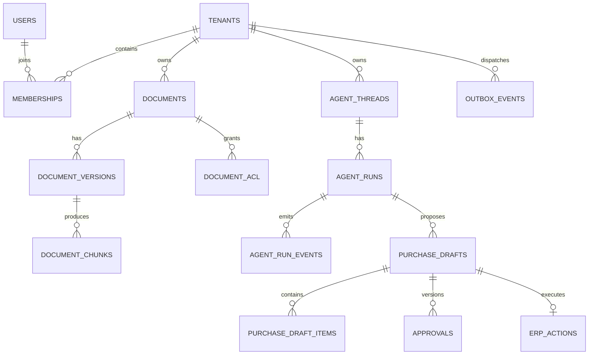

# PostgreSQL Data Model v0.1

> Logical schema/design specification; **no migration files or running database have been created yet**. PostgreSQL 16+ proposed. UUID primary keys; timestamps stored as `TIMESTAMPTZ` (UTC); quantities/prices stored as `NUMERIC`. Synthetic test data only.

## Entity groups



## 1. Identity

```sql
CREATE EXTENSION IF NOT EXISTS pgcrypto;
CREATE TABLE tenants (
  id uuid PRIMARY KEY DEFAULT gen_random_uuid(),
  name varchar(120) NOT NULL,
  status varchar(20) NOT NULL DEFAULT 'active'
    CHECK (status IN ('active','suspended')),
  created_at timestamptz NOT NULL DEFAULT now()
);
CREATE TABLE users (
  id uuid PRIMARY KEY DEFAULT gen_random_uuid(),
  email varchar(255) NOT NULL UNIQUE,
  password_hash text NOT NULL,
  status varchar(20) NOT NULL DEFAULT 'active'
    CHECK (status IN ('active','disabled')),
  created_at timestamptz NOT NULL DEFAULT now()
);
CREATE TABLE memberships (
  tenant_id uuid NOT NULL REFERENCES tenants(id),
  user_id uuid NOT NULL REFERENCES users(id),
  role varchar(20) NOT NULL
    CHECK (role IN ('admin','manager','staff','viewer')),
  PRIMARY KEY (tenant_id,user_id)
);
```

**Production note:** normalize email addresses with a documented policy and use a uniqueness strategy compatible with that policy; implement password reset/session revocation and privileged-role auditing.

## 2. Knowledge

```sql
CREATE TABLE documents (
  id uuid PRIMARY KEY DEFAULT gen_random_uuid(),
  tenant_id uuid NOT NULL REFERENCES tenants(id),
  title varchar(255) NOT NULL,
  owner_id uuid NOT NULL REFERENCES users(id),
  current_version integer,
  status varchar(20) NOT NULL DEFAULT 'active'
    CHECK (status IN ('active','deleted')),
  created_at timestamptz NOT NULL DEFAULT now(),
  UNIQUE (tenant_id,id)
);
CREATE TABLE document_acl (
  tenant_id uuid NOT NULL,
  document_id uuid NOT NULL,
  role varchar(20) NOT NULL
    CHECK (role IN ('admin','manager','staff','viewer')),
  PRIMARY KEY (tenant_id,document_id,role),
  FOREIGN KEY (tenant_id,document_id)
    REFERENCES documents(tenant_id,id) ON DELETE CASCADE
);
CREATE TABLE document_versions (
  id uuid PRIMARY KEY DEFAULT gen_random_uuid(),
  tenant_id uuid NOT NULL,
  document_id uuid NOT NULL,
  version integer NOT NULL CHECK (version > 0),
  storage_key text NOT NULL,
  sha256 char(64) NOT NULL,
  indexing_status varchar(20) NOT NULL DEFAULT 'pending'
    CHECK (indexing_status IN ('pending','processing','ready','failed')),
  created_at timestamptz NOT NULL DEFAULT now(),
  UNIQUE (tenant_id,id),
  UNIQUE (tenant_id,document_id,version),
  FOREIGN KEY (tenant_id,document_id) REFERENCES documents(tenant_id,id)
);
CREATE TABLE document_chunks (
  id uuid PRIMARY KEY DEFAULT gen_random_uuid(),
  tenant_id uuid NOT NULL,
  document_version_id uuid NOT NULL,
  chunk_index integer NOT NULL CHECK (chunk_index >= 0),
  content text NOT NULL,
  page_number integer,
  token_count integer,
  vector_point_id uuid,
  created_at timestamptz NOT NULL DEFAULT now(),
  UNIQUE (tenant_id,document_version_id,chunk_index),
  FOREIGN KEY (tenant_id,document_version_id)
    REFERENCES document_versions(tenant_id,id)
);
```

**Required migration refinement:** add a safe published-version mechanism for `documents.current_version` to ensure the referenced version exists and is `ready`; ensure owner is a member of the document tenant (composite FK or invariant validated transactionally). Never publish a new version until indexing completed. Identical-content uploads require a documented duplicate/version policy, ideally enforced with a transaction lock.

Qdrant payload: `tenant_id, document_id, document_version_id, chunk_id, allowed_roles`, embedding model/version. Filter by server-trusted tenant and ACL before retrieval; revalidate against PostgreSQL before returning snippets.

## 3. Agent runs

```sql
CREATE TABLE agent_threads (
  id uuid PRIMARY KEY DEFAULT gen_random_uuid(),
  tenant_id uuid NOT NULL REFERENCES tenants(id),
  user_id uuid NOT NULL REFERENCES users(id),
  title varchar(255),
  created_at timestamptz NOT NULL DEFAULT now(),
  UNIQUE (tenant_id,id)
);
CREATE TABLE agent_runs (
  id uuid PRIMARY KEY DEFAULT gen_random_uuid(),
  tenant_id uuid NOT NULL,
  thread_id uuid NOT NULL,
  request_id uuid NOT NULL,
  status varchar(24) NOT NULL DEFAULT 'queued'
    CHECK (status IN ('queued','running','waiting_approval','completed','failed','cancelled')),
  input_text text NOT NULL,
  output_text text,
  error_code varchar(80),
  started_at timestamptz,
  finished_at timestamptz,
  created_at timestamptz NOT NULL DEFAULT now(),
  UNIQUE (tenant_id,id),
  UNIQUE (tenant_id,request_id),
  FOREIGN KEY (tenant_id,thread_id) REFERENCES agent_threads(tenant_id,id)
);
CREATE TABLE agent_run_events (
  id bigint GENERATED ALWAYS AS IDENTITY PRIMARY KEY,
  tenant_id uuid NOT NULL,
  run_id uuid NOT NULL,
  node_name varchar(80) NOT NULL,
  event_type varchar(40) NOT NULL,
  payload jsonb NOT NULL DEFAULT '{}'::jsonb,
  trace_id varchar(64),
  created_at timestamptz NOT NULL DEFAULT now(),
  FOREIGN KEY (tenant_id,run_id) REFERENCES agent_runs(tenant_id,id)
);
CREATE INDEX idx_agent_runs_status
  ON agent_runs(tenant_id,status,created_at DESC);
CREATE INDEX idx_agent_events_run
  ON agent_run_events(tenant_id,run_id,id);
```

Use LangGraph's supported PostgreSQL checkpoint schema for snapshots; do not invent a second competing snapshot table. Event payloads must be sanitized and bounded.

## 4. Purchase approval and ERP write

```sql
CREATE TABLE purchase_drafts (
  id uuid PRIMARY KEY DEFAULT gen_random_uuid(),
  tenant_id uuid NOT NULL REFERENCES tenants(id),
  agent_run_id uuid NOT NULL,
  created_by uuid NOT NULL REFERENCES users(id),
  status varchar(24) NOT NULL DEFAULT 'draft'
    CHECK (status IN ('draft','pending_approval','approved','rejected','stale','executed','failed')),
  draft_version integer NOT NULL DEFAULT 1 CHECK (draft_version > 0),
  source_snapshot_hash char(64) NOT NULL,
  policy_version_id uuid,
  currency char(3) NOT NULL DEFAULT 'TWD',
  total_amount numeric(16,2) NOT NULL DEFAULT 0 CHECK (total_amount >= 0),
  created_at timestamptz NOT NULL DEFAULT now(),
  UNIQUE (tenant_id,id),
  FOREIGN KEY (tenant_id,agent_run_id) REFERENCES agent_runs(tenant_id,id)
);
CREATE TABLE purchase_draft_items (
  id uuid PRIMARY KEY DEFAULT gen_random_uuid(),
  tenant_id uuid NOT NULL,
  draft_id uuid NOT NULL,
  sku varchar(80) NOT NULL,
  suggested_qty numeric(14,3) NOT NULL CHECK (suggested_qty > 0),
  unit_cost numeric(14,2) NOT NULL CHECK (unit_cost >= 0),
  reasoning jsonb NOT NULL DEFAULT '{}'::jsonb,
  FOREIGN KEY (tenant_id,draft_id) REFERENCES purchase_drafts(tenant_id,id)
);
CREATE TABLE approvals (
  id uuid PRIMARY KEY DEFAULT gen_random_uuid(),
  tenant_id uuid NOT NULL,
  draft_id uuid NOT NULL,
  draft_version integer NOT NULL,
  status varchar(20) NOT NULL DEFAULT 'pending'
    CHECK (status IN ('pending','approved','rejected','expired')),
  requested_by uuid NOT NULL REFERENCES users(id),
  decided_by uuid REFERENCES users(id),
  decided_at timestamptz,
  decision_note text,
  created_at timestamptz NOT NULL DEFAULT now(),
  UNIQUE (tenant_id,id),
  UNIQUE (tenant_id,draft_id,draft_version),
  FOREIGN KEY (tenant_id,draft_id) REFERENCES purchase_drafts(tenant_id,id)
);
CREATE TABLE erp_actions (
  id uuid PRIMARY KEY DEFAULT gen_random_uuid(),
  tenant_id uuid NOT NULL,
  draft_id uuid NOT NULL,
  idempotency_key uuid NOT NULL,
  status varchar(20) NOT NULL DEFAULT 'pending'
    CHECK (status IN ('pending','executing','succeeded','failed','unknown')),
  external_document_id varchar(100),
  error_code varchar(80),
  created_at timestamptz NOT NULL DEFAULT now(),
  UNIQUE (tenant_id,draft_id),
  UNIQUE (tenant_id,idempotency_key),
  FOREIGN KEY (tenant_id,draft_id) REFERENCES purchase_drafts(tenant_id,id)
);
CREATE TABLE outbox_events (
  id uuid PRIMARY KEY DEFAULT gen_random_uuid(),
  tenant_id uuid NOT NULL REFERENCES tenants(id),
  aggregate_type varchar(60) NOT NULL,
  aggregate_id uuid NOT NULL,
  event_type varchar(80) NOT NULL,
  payload jsonb NOT NULL DEFAULT '{}'::jsonb,
  status varchar(20) NOT NULL DEFAULT 'pending'
    CHECK (status IN ('pending','processing','delivered','failed')),
  attempts integer NOT NULL DEFAULT 0 CHECK (attempts >= 0),
  available_at timestamptz NOT NULL DEFAULT now(),
  created_at timestamptz NOT NULL DEFAULT now()
);
CREATE INDEX idx_outbox_pending
  ON outbox_events(status,available_at) WHERE status IN ('pending','failed');
```

**Transactional invariants (implementation requirements):**
- Only legal status transitions under row lock / optimistic version check.
- Draft modifications increment version and invalidate existing approval; freeze draft items while pending/approved.
- Self-approval denied; approval permission checked against current membership and designated warehouse scope.
- Decision and outbox insert committed together.
- ERP endpoint must enforce uniqueness for the same idempotency key; timeout leads to reconciliation, never blind retry.
- `source_snapshot_hash` detects changes but is not sufficient alone: re-fetch stock, purchasing policy, price and scope before write.
- Add tenant-scoped user/membership foreign keys, row-level security and business-specific indexes during executable migrations.

## 5. Operational tables (to implement)

| Table | Fields | Purpose |
|---|---|---|
| background_jobs | id, tenant_id, type, status, attempts, next_run_at, payload | Ingestion / retry |
| audit_logs | id, tenant_id, actor_id, action, resource_id, before_hash, after_hash, created_at | Append-only audit |
| llm_usage | id, tenant_id, run_id, provider, model, input_tokens, output_tokens, estimated_cost, latency_ms | Model accounting |
| erp_tool_calls | id, tenant_id, run_id, tool_name, input_hash, output_hash, status, duration_ms | Tool audit |

## Migration conventions

- Schema above is an architectural baseline, **not final deployable DDL**.
- Implement with Alembic and deterministic reversible migrations where feasible.
- Use compound `(tenant_id,id)` keys and tenant-scoped foreign keys for tenant-owned relationships.
- Index access patterns by tenant + date/status; verify EXPLAIN on realistic synthetic fixtures.
- Use `numeric` for business amounts and structured test fixtures for stock arithmetic.
- Assess PostgreSQL RLS with separate application DB roles; test no bypass via owner/superuser.
