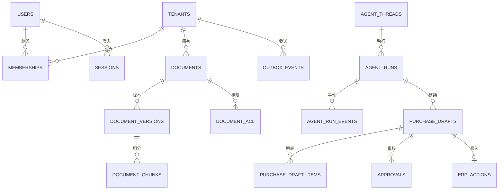

# PostgreSQL 資料庫 Schema（結構）規格 v0.1

> **整體仍為設計規格。** M1 的 `tenants`、`users`、`memberships`、`sessions` 與 Demo ERP 基礎資料表已有 Migration；M2 文件、ACL、上傳狀態、索引工作及鍵登錄以 Migration 管理。Registry 的最新實作與測試狀態見下方「鍵登錄實作狀態」及[開發進度](../development/PROGRESS.md)。其餘資料表仍未實作。詳見 [M1-01 驗證紀錄](../development/M1-01-VERIFICATION.md)。建議 PostgreSQL 16+。識別碼使用 UUID、時間使用 `TIMESTAMPTZ`（UTC）、金額與數量使用 `NUMERIC`。

## 1. 資料庫邊界

- **Agent 應用資料庫**：身分、文件版本、Agent 執行、採購草稿、核准、Outbox（交易式寄件匣）、稽核紀錄。
- **C# + ASP.NET Core Demo ERP 資料庫**：商品、倉庫、庫存、銷售、未到貨採購、正式採購單與 ERP 端的 Idempotency（冪等性）紀錄。
- 優先採用兩個獨立 PostgreSQL Database（資料庫），至少須使用獨立 Schema（結構綱要）與資料庫帳號。兩套系統僅透過 API 整合，不允許 Agent 直接修改 ERP 表格。
- ASP.NET Core 採 **EF Core + Npgsql** 管理 ERP Migration（結構遷移）；Python Agent 採 **Alembic** 管理應用資料庫 Migration。不要讓兩套 ORM 同時管理同一組表格。

## 2. 應用資料關聯



## 3. Identity（身分與租戶）

```sql
CREATE EXTENSION IF NOT EXISTS pgcrypto;

CREATE TABLE tenants (
  id uuid PRIMARY KEY DEFAULT gen_random_uuid(),
  name varchar(120) NOT NULL,
  status varchar(20) NOT NULL DEFAULT 'active'
    CHECK (status IN ('active','suspended')),
  created_at timestamptz NOT NULL DEFAULT now()
);

CREATE TABLE users (
  id uuid PRIMARY KEY DEFAULT gen_random_uuid(),
  email varchar(255) NOT NULL UNIQUE,
  password_hash text NOT NULL,
  status varchar(20) NOT NULL DEFAULT 'active'
    CHECK (status IN ('active','disabled')),
  created_at timestamptz NOT NULL DEFAULT now()
);

CREATE UNIQUE INDEX ux_users_email_lower ON users (lower(email));

CREATE TABLE memberships (
  tenant_id uuid NOT NULL REFERENCES tenants(id),
  user_id uuid NOT NULL REFERENCES users(id),
  role varchar(20) NOT NULL
    CHECK (role IN ('admin','manager','staff','viewer')),
  PRIMARY KEY (tenant_id,user_id)
);

CREATE TABLE sessions (
  id uuid PRIMARY KEY,
  user_id uuid NOT NULL REFERENCES users(id) ON DELETE CASCADE,
  created_at timestamptz NOT NULL DEFAULT now(),
  expires_at timestamptz NOT NULL,
  revoked_at timestamptz,
  CONSTRAINT ck_sessions_expires_after_creation CHECK (expires_at > created_at),
  CONSTRAINT ck_sessions_revoked_after_creation CHECK (revoked_at IS NULL OR revoked_at >= created_at)
);

CREATE INDEX ix_sessions_user_expires ON sessions(user_id, expires_at);

CREATE TABLE membership_warehouse_scopes (
  tenant_id uuid NOT NULL,
  user_id uuid NOT NULL,
  warehouse_code varchar(80) NOT NULL CHECK (length(trim(warehouse_code)) > 0),
  PRIMARY KEY (tenant_id, user_id, warehouse_code),
  FOREIGN KEY (tenant_id, user_id) REFERENCES memberships(tenant_id, user_id) ON DELETE CASCADE
);

CREATE TABLE tenant_warehouses (
  tenant_id uuid NOT NULL REFERENCES tenants(id),
  warehouse_code varchar(80) NOT NULL CHECK (length(trim(warehouse_code)) > 0),
  PRIMARY KEY (tenant_id, warehouse_code),
  UNIQUE (warehouse_code)
);

ALTER TABLE membership_warehouse_scopes ADD CONSTRAINT fk_scope_tenant_warehouse
  FOREIGN KEY (tenant_id, warehouse_code)
  REFERENCES tenant_warehouses(tenant_id, warehouse_code);
```

`sessions.id` 作為 JWT 的 `jti`，每次受保護請求須檢查工作階段未撤銷且未過期。建帳時 Email 轉為小寫並去除前後空白，資料庫另以 `ux_users_email_lower` 阻止大小寫重複；停權與權限變更稽核仍待實作。
`membership_warehouse_scopes` 由 `0004_warehouse_scopes` Migration 建立；每個倉庫需明確授權，沒有資料列即沒有倉庫權限，不以 admin 角色自動推定全部倉庫。`warehouse_code` 對應 ERP 倉庫代碼；ERP 位於獨立資料庫，無法建立跨資料庫 Foreign Key（外鍵），讀取 ERP 前仍須驗證代碼存在及租戶歸屬。
`tenant_warehouses` 由 `0005_tenant_warehouses` Migration 建立；倉庫代碼只能登錄至單一租戶，授權範圍的複合外鍵禁止指向其他租戶的倉庫。登錄流程及 ERP 端歸屬驗證仍待後續實作，不能只根據此表對 ERP 進行跨租戶讀取。

## 4. Knowledge（文件與索引）

`0006_documents` 已建立下列 `documents`、`document_versions`、`document_acl` 資料表，並以複合外鍵限制版本、ACL 與已選 `current_version` 必須屬於同一租戶及同一文件。`0007_document_upload_state` 新增儲存狀態及租戶內唯一的可選冪等鍵；`0008_document_user_acl` 可授權單一租戶成員，成員資格撤銷時連動移除；`0009_document_index_jobs` 登錄每版本唯一的待索引工作。`document_chunks` 仍為規劃中。下列 DDL 為設計摘要；實際約束以 Migration 為準。

```sql
CREATE TABLE documents (
  id uuid PRIMARY KEY DEFAULT gen_random_uuid(),
  tenant_id uuid NOT NULL REFERENCES tenants(id),
  title varchar(255) NOT NULL,
  owner_id uuid NOT NULL REFERENCES users(id),
  current_version integer,
  status varchar(20) NOT NULL DEFAULT 'active'
    CHECK (status IN ('active','deleted')),
  created_at timestamptz NOT NULL DEFAULT now(),
  UNIQUE (tenant_id,id)
);

CREATE TABLE document_acl (
  tenant_id uuid NOT NULL,
  document_id uuid NOT NULL,
  role varchar(20) NOT NULL
    CHECK (role IN ('admin','manager','staff','viewer')),
  PRIMARY KEY (tenant_id,document_id,role),
  FOREIGN KEY (tenant_id,document_id)
    REFERENCES documents(tenant_id,id) ON DELETE CASCADE
);

CREATE TABLE document_user_acl (
  tenant_id uuid NOT NULL,
  document_id uuid NOT NULL,
  user_id uuid NOT NULL,
  PRIMARY KEY (tenant_id,document_id,user_id),
  FOREIGN KEY (tenant_id,document_id)
    REFERENCES documents(tenant_id,id) ON DELETE CASCADE,
  FOREIGN KEY (tenant_id,user_id)
    REFERENCES memberships(tenant_id,user_id) ON DELETE CASCADE
);

CREATE TABLE document_versions (
  id uuid PRIMARY KEY DEFAULT gen_random_uuid(),
  tenant_id uuid NOT NULL,
  document_id uuid NOT NULL,
  version integer NOT NULL CHECK (version > 0),
  storage_key text NOT NULL,
  sha256 char(64) NOT NULL,
  storage_status varchar(20) NOT NULL DEFAULT 'pending_upload'
    CHECK (storage_status IN ('pending_upload','stored','failed')),
  idempotency_key uuid,
  indexing_status varchar(20) NOT NULL DEFAULT 'pending'
    CHECK (indexing_status IN ('pending','processing','ready','failed')),
  created_at timestamptz NOT NULL DEFAULT now(),
  UNIQUE (tenant_id,id),
  UNIQUE (tenant_id,document_id,version),
  UNIQUE (tenant_id,idempotency_key),
  FOREIGN KEY (tenant_id,document_id)
    REFERENCES documents(tenant_id,id)
);

CREATE TABLE document_index_jobs (
  id uuid PRIMARY KEY DEFAULT gen_random_uuid(),
  tenant_id uuid NOT NULL,
  document_version_id uuid NOT NULL,
  status varchar(20) NOT NULL DEFAULT 'pending'
    CHECK (status IN ('pending','processing','completed','failed')),
  attempt_count integer NOT NULL DEFAULT 0 CHECK (attempt_count >= 0),
  created_at timestamptz NOT NULL DEFAULT now(),
  UNIQUE (tenant_id,document_version_id),
  FOREIGN KEY (tenant_id,document_version_id)
    REFERENCES document_versions(tenant_id,id)
);

CREATE TABLE document_chunks (
  id uuid PRIMARY KEY DEFAULT gen_random_uuid(),
  tenant_id uuid NOT NULL,
  document_version_id uuid NOT NULL,
  chunk_index integer NOT NULL CHECK (chunk_index >= 0),
  content text NOT NULL,
  page_number integer,
  token_count integer,
  vector_point_id uuid,
  created_at timestamptz NOT NULL DEFAULT now(),
  UNIQUE (tenant_id,document_version_id,chunk_index),
  FOREIGN KEY (tenant_id,document_version_id)
    REFERENCES document_versions(tenant_id,id)
);
```

必要不變條件：發佈的 `current_version` 必須存在、索引為 `ready`；Owner（擁有者）必須是同 Tenant 的成員；重複 SHA256 應以交易鎖及明確版本政策處理。Qdrant Payload（負載欄位）應帶 `tenant_id`、`document_id`、`version_id`、`chunk_id`、`allowed_roles`。檢索後仍需由 PostgreSQL 重新檢查 ACL。

目前資料庫保證 `current_version` 指向現有且同租戶的版本、儲存狀態值有效，以及同租戶非空冪等鍵不重複；`0011` 鍵登錄限制詳見第 8 節。既有版本在 Migration 後保守標為 `pending_upload`，不能據此判定物件已存在；上傳流程須先對帳 MinIO 才可標為 `stored`。`failed` 僅代表某次上傳尚未確認成功、允許以同一冪等鍵重試；由於先前逾時的 MinIO PUT 可能晚到，`failed` 不代表物件不存在，也不能作為刪除授權。資料庫提交結果不明時，須以同鍵重新讀取狀態並對帳。孤兒物件候選登錄、鍵輪替及安全清理尚未實作，無法以目前 Schema 安全辨認或刪除候選物件。**`ready` 後發布、Owner 成員資格、同 SHA256 去重與檢索時 ACL 重驗尚未實作**。現行單一文件 Metadata 讀取已有 Tenant Membership 與 ACL 檢查；在對應 API／交易測試完成前，不可開放原文讀取或知識檢索。

## 5. Agent 執行歷程

```sql
CREATE TABLE agent_threads (
  id uuid PRIMARY KEY DEFAULT gen_random_uuid(),
  tenant_id uuid NOT NULL REFERENCES tenants(id),
  user_id uuid NOT NULL REFERENCES users(id),
  title varchar(255),
  created_at timestamptz NOT NULL DEFAULT now(),
  UNIQUE (tenant_id,id)
);

CREATE TABLE agent_runs (
  id uuid PRIMARY KEY DEFAULT gen_random_uuid(),
  tenant_id uuid NOT NULL,
  thread_id uuid NOT NULL,
  request_id uuid NOT NULL,
  status varchar(24) NOT NULL DEFAULT 'queued'
    CHECK (status IN ('queued','running','waiting_approval','completed','failed','cancelled')),
  input_text text NOT NULL,
  output_text text,
  error_code varchar(80),
  started_at timestamptz,
  finished_at timestamptz,
  created_at timestamptz NOT NULL DEFAULT now(),
  UNIQUE (tenant_id,id),
  UNIQUE (tenant_id,request_id),
  FOREIGN KEY (tenant_id,thread_id)
    REFERENCES agent_threads(tenant_id,id)
);

CREATE TABLE agent_run_events (
  id bigint GENERATED ALWAYS AS IDENTITY PRIMARY KEY,
  tenant_id uuid NOT NULL,
  run_id uuid NOT NULL,
  node_name varchar(80) NOT NULL,
  event_type varchar(40) NOT NULL,
  payload jsonb NOT NULL DEFAULT '{}'::jsonb,
  trace_id varchar(64),
  created_at timestamptz NOT NULL DEFAULT now(),
  FOREIGN KEY (tenant_id,run_id)
    REFERENCES agent_runs(tenant_id,id)
);

CREATE INDEX idx_runs_status
  ON agent_runs(tenant_id,status,created_at DESC);
CREATE INDEX idx_run_events
  ON agent_run_events(tenant_id,run_id,id);
```

LangGraph Checkpoint（流程狀態快照）使用官方 PostgreSQL Checkpointer 管理，不自建重複的 State Snapshot。事件採 Append-only（僅新增），Payload 必須遮蔽機密且限制大小。

## 6. 採購草稿、核准與 ERP 寫入

```sql
CREATE TABLE purchase_drafts (
  id uuid PRIMARY KEY DEFAULT gen_random_uuid(),
  tenant_id uuid NOT NULL REFERENCES tenants(id),
  agent_run_id uuid NOT NULL,
  created_by uuid NOT NULL REFERENCES users(id),
  status varchar(24) NOT NULL DEFAULT 'draft'
    CHECK (status IN ('draft','pending_approval','approved','rejected','stale','executed','failed')),
  draft_version integer NOT NULL DEFAULT 1 CHECK (draft_version > 0),
  source_snapshot_hash char(64) NOT NULL,
  policy_version_id uuid,
  currency char(3) NOT NULL DEFAULT 'TWD',
  total_amount numeric(16,2) NOT NULL DEFAULT 0 CHECK (total_amount >= 0),
  created_at timestamptz NOT NULL DEFAULT now(),
  UNIQUE (tenant_id,id),
  FOREIGN KEY (tenant_id,agent_run_id)
    REFERENCES agent_runs(tenant_id,id)
);

CREATE TABLE purchase_draft_items (
  id uuid PRIMARY KEY DEFAULT gen_random_uuid(),
  tenant_id uuid NOT NULL,
  draft_id uuid NOT NULL,
  sku varchar(80) NOT NULL,
  suggested_qty numeric(14,3) NOT NULL CHECK (suggested_qty > 0),
  unit_cost numeric(14,2) NOT NULL CHECK (unit_cost >= 0),
  reasoning jsonb NOT NULL DEFAULT '{}'::jsonb,
  FOREIGN KEY (tenant_id,draft_id)
    REFERENCES purchase_drafts(tenant_id,id)
);

CREATE TABLE approvals (
  id uuid PRIMARY KEY DEFAULT gen_random_uuid(),
  tenant_id uuid NOT NULL,
  draft_id uuid NOT NULL,
  draft_version integer NOT NULL,
  status varchar(20) NOT NULL DEFAULT 'pending'
    CHECK (status IN ('pending','approved','rejected','expired')),
  requested_by uuid NOT NULL REFERENCES users(id),
  decided_by uuid REFERENCES users(id),
  decided_at timestamptz,
  decision_note text,
  created_at timestamptz NOT NULL DEFAULT now(),
  UNIQUE (tenant_id,id),
  UNIQUE (tenant_id,draft_id,draft_version),
  FOREIGN KEY (tenant_id,draft_id)
    REFERENCES purchase_drafts(tenant_id,id)
);

CREATE TABLE erp_actions (
  id uuid PRIMARY KEY DEFAULT gen_random_uuid(),
  tenant_id uuid NOT NULL,
  draft_id uuid NOT NULL,
  idempotency_key uuid NOT NULL,
  status varchar(20) NOT NULL DEFAULT 'pending'
    CHECK (status IN ('pending','executing','succeeded','failed','unknown')),
  external_document_id varchar(100),
  error_code varchar(80),
  created_at timestamptz NOT NULL DEFAULT now(),
  UNIQUE (tenant_id,draft_id),
  UNIQUE (tenant_id,idempotency_key),
  FOREIGN KEY (tenant_id,draft_id)
    REFERENCES purchase_drafts(tenant_id,id)
);

CREATE TABLE outbox_events (
  id uuid PRIMARY KEY DEFAULT gen_random_uuid(),
  tenant_id uuid NOT NULL REFERENCES tenants(id),
  aggregate_type varchar(60) NOT NULL,
  aggregate_id uuid NOT NULL,
  event_type varchar(80) NOT NULL,
  payload jsonb NOT NULL DEFAULT '{}'::jsonb,
  status varchar(20) NOT NULL DEFAULT 'pending'
    CHECK (status IN ('pending','processing','delivered','failed')),
  attempts integer NOT NULL DEFAULT 0 CHECK (attempts >= 0),
  available_at timestamptz NOT NULL DEFAULT now(),
  created_at timestamptz NOT NULL DEFAULT now()
);

CREATE INDEX idx_outbox_pending
  ON outbox_events(status,available_at)
  WHERE status IN ('pending','failed');
```

**交易規則**：Draft（草稿）送審後凍結明細；異動必須增加版本並重新核准。核准交易必須鎖定草稿與審核紀錄，同時提交 Outbox Event；ERP 端執行固定冪等鍵唯一約束，寫入結果未知時先對帳。禁止自行核准自己的採購草稿（職責分離）。

## 7. ASP.NET Core Demo ERP 資料模型（規劃）

M1 的商品、倉庫、庫存三張表已由 **EF Core Migration（資料庫結構遷移）** 建立；其餘表及欄位類型、FK 待 M3 細化。

| Table | 主要欄位 | 職責 |
|---|---|---|
| `erp_products` | id、sku、name、unit、is_active | 商品主檔 |
| `erp_warehouses` | id、code、name | 倉庫主檔 |
| `erp_inventory` | warehouse_id、product_id、on_hand、reserved、row_version | 庫存與並行版本 |
| `erp_sales_orders` | id、warehouse_id、status、sold_at | 銷售單主檔 |
| `erp_sales_items` | sales_order_id、product_id、quantity | 銷售明細 |
| `erp_purchase_orders` | id、status、idempotency_key、source_draft_id | 採購單主檔 |
| `erp_purchase_items` | order_id、product_id、quantity、unit_cost | 採購明細 |
| `erp_suppliers` | id、name、lead_time_days | 供應商交期 |
| `erp_idempotency_records` | key、payload_hash、status、result_id | 重試去重及對帳 |

ERP 端使用 PostgreSQL Transaction（交易）與 Unique Constraint（唯一約束）保證同一冪等鍵不重複產生採購單。庫存並行更新使用可驗證的版本控制，不依賴 LLM。

## 8. 鍵登錄實作狀態（Migration `0011_document_key_registry`）

本節記錄 Migration 與隔離測試證據；正式環境的角色配置及備份還原仍須另行驗證。

- `document_storage_keys` 以固定邏輯 `namespace = 'documents'` 和完整 `storage_key` 作為全域唯一身分，並記錄 Tenant、Document、Version、Generation 與 `live`／`retired` 狀態。Generation 沿用 canonical key 尾端 UUID；這是世代唯一識別，不能推論其時間先後或歷史寫入排空。
- `document_versions` 的生成欄位以複合外鍵指向完全相符且狀態固定為 `live` 的 Registry 列。資料庫觸發器在版本建立交易內登錄 Live Key；版本儲存身分不可更新。Registry 禁止身分變更、退役後復活、列刪除及 TRUNCATE；退役只允許 `live → retired`。
- Migration 將 `0010` 現有版本鍵與退役紀錄回填至 Registry，並以不可自動更新的同名 View 保留舊預覽讀取介面。重複鍵、非 canonical key、現用鍵與墓碑衝突、舊墓碑表或欄位存在明確 ACL、啟用 RLS、舊表擁有者與遷移角色不同、非 READ COMMITTED 交易或鎖無法立即取得時，Migration fail closed；不自動更改不合規業務資料。Migration 固定操作 `public` Schema，downgrade 明確拒絕，以保留鍵身分與墓碑。
- 一次性隔離 PostgreSQL 已驗證空庫升級、既有 `0010` 資料回填、衝突時交易回滾、舊墓碑唯讀相容 View、鎖競爭、非預設隔離級別、非 owner 權限、退役限制及拒絕 downgrade。一次性隔離 MinIO／PostgreSQL 已跑 PDF 上傳、同冪等鍵重試與 ACL 撤銷回歸；測試沒有呼叫 MinIO DELETE。測試指令、數量及警告以 `PROGRESS.md` 的當輪紀錄為準。
- 現有 Compose 的 API 與 Migration 共用資料庫特權帳號；本切片沒有完成正式服務角色拆分，也未驗證正式環境 Preview 角色的 SELECT 權限部署。正式環境須控管新物件的預設權限；資料庫擁有者及具停用觸發器權限者可繞過一般防護。
- 備份必須在同一一致性時間點包含完整 Schema 與資料、Registry、版本、外鍵、觸發器、必要權限及永久墓碑。不可把只有部分資料表的 data-only 備份直接附加到已啟用觸發器的現有資料庫；舊時間點還原或落後故障切換後，須隔離寫入、發布及刪除，補齊永久鍵紀錄並完成對帳後才能恢復服務。
- Registry 不提供鍵輪替／恢復服務，也不實作 Cleaner 或物件 DELETE。`waiting_fence` 不是刪除授權；可靠排空舊 PUT、正式租戶資料面隔離與故障復原仍是未解除的放行條件。

## 9. 待實作營運資料表與 Migration 限制

`background_jobs`、`audit_logs`、`llm_usage`、`erp_tool_calls` 用於工作、稽核、成本與工具歷程。所有 Tenant 資料需補齊複合 `(tenant_id,id)` FK 或等效強制不變條件，並評估 PostgreSQL RLS（資料列層級安全）。

**本文件是 DDL 設計基準，尚非可直接完成部署的最終 Migration。** 落地後應補索引、Owner 成員約束、文件發布版本約束、RLS、安全角色及 SQL EXPLAIN 驗證。
